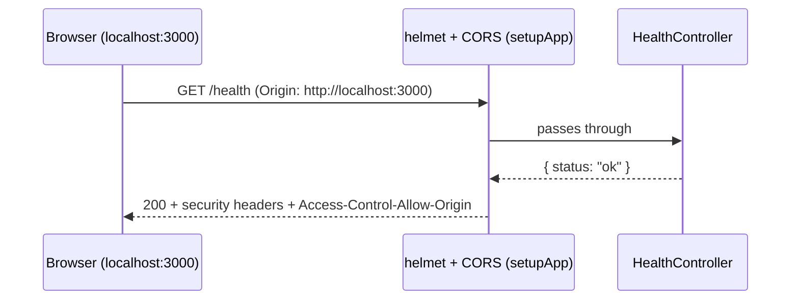

# 01 · Gateway skeleton
Repos: backend:gateway   Brief: [SeatLock MVP](../../../seatlock-platform/docs/briefs/2026-11-03-seatlock-mvp.md)   Plan: [01 gateway skeleton](../../../seatlock-platform/docs/plans/2026-11-04-01-gateway-skeleton.md)   Date: 2026-11-05

## What we built
A NestJS 12 app on port 4000 that answers `GET /health` with `{"status":"ok"}`. It refuses to start if its settings are wrong, and every response carries security headers and a strict CORS rule. There's no login, NATS or database yet; later features build on this.

## Why it's built this way
- **One public door.** The gateway is the only service the internet can reach. The other services only talk over NATS. So security basics (headers, CORS, no stack traces) live here first.
- **NodeAdapter, not Express** ([ADR 0002](../../../seatlock-platform/docs/adr/0002-node-http-adapter.md)). Fewer packages, and Node's own HTTP server is enough for a gateway.
- **ESM and Vitest** ([ADR 0001](../../../seatlock-platform/docs/adr/0001-esm-and-vitest.md)). That's why every relative import ends in `.js`.
- **Fail fast on config.** A wrong `PORT` should stop the app at boot with a clear message, not break something an hour later.

## How a request flows


## Files added or changed
| File | Layer | Purpose |
|---|---|---|
| `src/main.ts` | bootstrap | Creates the app with `NodeAdapter`, reads `HOST`/`PORT`, calls `setupApp`, listens |
| `src/app.module.ts` | root module | Imports `ConfigModule`, `ObserveModule`, `HealthModule` |
| `src/app.setup.ts` | bootstrap | helmet, CORS, shutdown hooks. Shared by `main.ts` and e2e tests |
| `src/config/env.schema.ts` | config | Zod schema for the environment |
| `src/health/*` | feature | Health module, controller and response type |
| `src/observe.ts` | monitoring | Creates the Observe module and instrument |
| `src/config/env.schema.spec.ts` | tests | Unit tests for criterion 2 |
| `test/health.e2e-spec.ts`, `test/security.e2e-spec.ts` | tests | e2e tests for criteria 1, 3, 4, 5 |

## Key code, explained

### The environment schema - `src/config/env.schema.ts`
```ts
export const envSchema = z.object({
  NODE_ENV: z.enum(['development', 'production', 'test']).default('development'),
  HOST: z.string().min(1).default('127.0.0.1'),
  PORT: z.coerce.number().int().min(1).max(65535).default(4000),
  WEB_ORIGIN: z.url().default('http://localhost:3000'),
});
export type Env = z.infer<typeof envSchema>;
```
- One place that says which settings exist, their types and their safe defaults. `Env` is the TypeScript type, derived from the schema, so the two can't drift apart.
- Concept: env values are always text. `z.coerce.number()` turns `'4000'` into `4000`, and `'abc'` into `NaN`, which fails ([Zod coercion](https://zod.dev/api#coercion)).
- Watch out: `HOST` defaults to `127.0.0.1`, so the dev server isn't reachable from other devices on your Wi-Fi.

### Validating at boot - `src/app.module.ts`
```ts
ConfigModule.forRoot({
  isGlobal: true,
  ignoreEnvFile: true,
  validationSchema: envSchema,
}),
```
- `validationSchema` accepts a Zod schema. A bad value stops the app with `Config validation error: PORT: Invalid input...` ([configuration docs](https://docs.nestjs.com/techniques/configuration)).
- `ignoreEnvFile: true` because Node's `--env-file .env` (in the npm scripts) already loads the file. One loader, not two.
- Watch out: `start:prod` doesn't load `.env`. In production, the server sets real environment variables.

### Typed config - `src/main.ts`
```ts
const config = app.get<ConfigService<Env, true>>(ConfigService);
const port = config.get('PORT', { infer: true });
const host = config.get('HOST', { infer: true });

setupApp(app);
await app.listen(port, host);
```
- `ConfigService<Env, true>` plus `{ infer: true }` gives `port` the type `number`, and a misspelled key is a compile error.
- Watch out: never read `process.env.PORT` directly in app code. It's unvalidated text.

### One shared setup - `src/app.setup.ts`
```ts
export function setupApp(app: INestApplication): void {
  const config = app.get<ConfigService<Env, true>>(ConfigService);

  app.use(helmet());
  app.enableCors({ origin: config.get('WEB_ORIGIN', { infer: true }) });
  app.enableShutdownHooks();
}
```
- `main.ts` and the e2e tests both call this, so the tests check the same app that runs in production.
- `helmet()` adds headers like `X-Content-Type-Options: nosniff` ([helmet docs](https://docs.nestjs.com/security/helmet)).
- CORS allows one exact origin, never `*` ([CORS docs](https://docs.nestjs.com/security/cors)).
- `enableShutdownHooks()` lets the app close cleanly on `Ctrl+C` or when the server sends a stop signal.

### The CORS test - `test/security.e2e-spec.ts`
```ts
it('never allows another origin', async () => {
  const res = await request(app.getHttpServer())
    .get('/health')
    .set('Origin', 'https://evil.example');

  expect(res.headers['access-control-allow-origin']).not.toBe('https://evil.example');
});
```
- With one allowed origin, the server always replies `Access-Control-Allow-Origin: http://localhost:3000`, whoever asks. The **browser** compares it with the page's real origin and blocks a mismatch.
- So the test checks "the server never names the evil origin", not "the header is missing". The first version of this test assumed the header would be missing, and it failed. That's how we learned it.
- Watch out: CORS protects browser users. It doesn't stop curl or another server from calling the API. That's the auth guard's job, in a later feature.

## Database changes
None.

## Security notes
- Listens on `127.0.0.1` by default.
- Security headers on every response (helmet).
- Browsers allow only `WEB_ORIGIN` (CORS).
- Unknown routes return a JSON `404` without a stack trace.
- Observe keys live only in the git-ignored `.env`.
- Not yet: auth guard, rate limiting, input validation. They arrive with the auth feature. Until then, the only route is `/health`, which reveals nothing.

## How to run it
1. `npm install`
2. Copy `.env.example` to `.env` (optional: `npx @nestjs/observe link` for monitoring keys)
3. `npm run start:dev`
4. In another terminal: `curl.exe http://127.0.0.1:4000/health`

## How it's tested
| Command | What runs |
|---|---|
| `npm test` | 4 unit tests for the env schema |
| `npm run test:e2e` | 5 e2e tests: health, headers, CORS allow, CORS deny, JSON 404 |
| `npm run typecheck`, `npm run lint`, `npm run build` | Gates |
| `npm run start:prod` (after the build) | The compiled app serves `/health` |

## What you learned
- A test must be red **for the right reason**. A missing import or a `../stc/` typo isn't the right reason.
- `it.only` silently skips the other tests. Check the count ("4 passed"), not just the colour.
- Validate config at boot, and read it through a typed `ConfigService`.
- CORS is enforced by the browser, not the server.
- Commit only the files you mean to. `.env` and `.vscode/` stay out.

## Try it yourself
1. Add `LOG_LEVEL` to the env schema (`'debug' | 'info' | 'warn' | 'error'`, default `'info'`). Test first: the default applies, and `LOG_LEVEL=loud` fails and names `LOG_LEVEL`.
2. Add an e2e test that `/health` responses include `Strict-Transport-Security` (helmet sets it). Read helmet's docs to see what it does.
3. In PowerShell, run `$env:PORT="abc"`, then `npm run start:dev`, and read the error. Clean up with `Remove-Item Env:PORT`.
